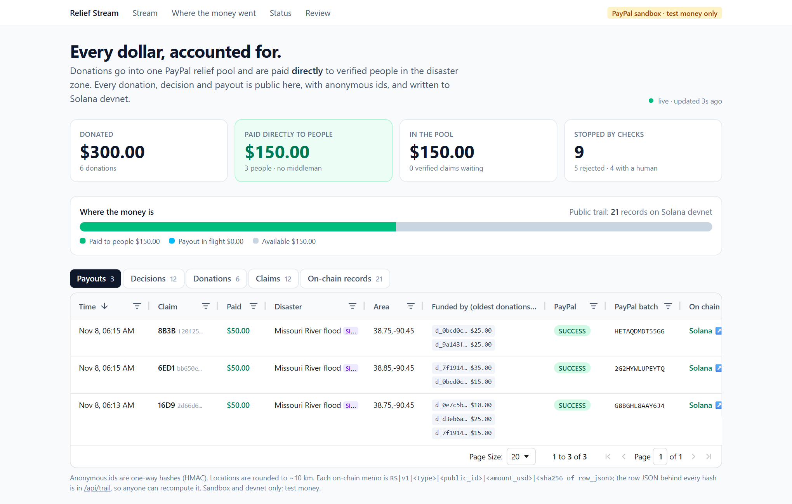
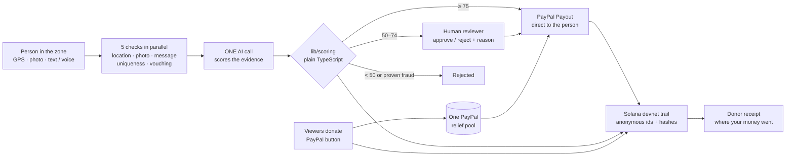
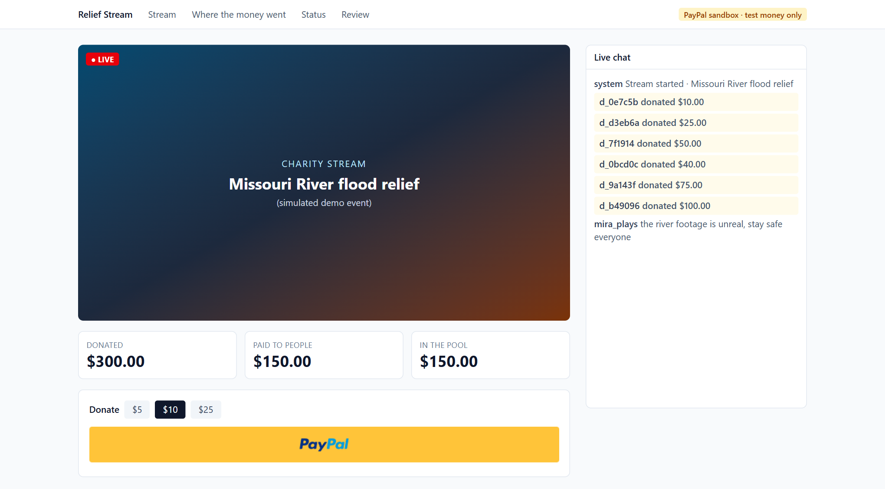
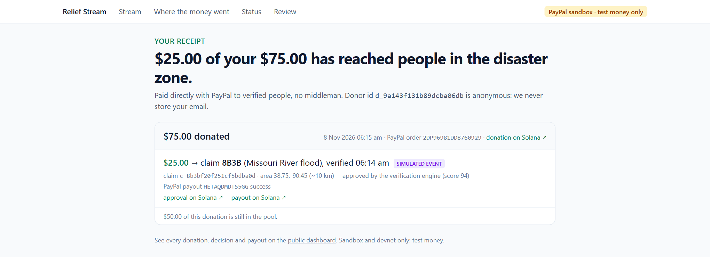
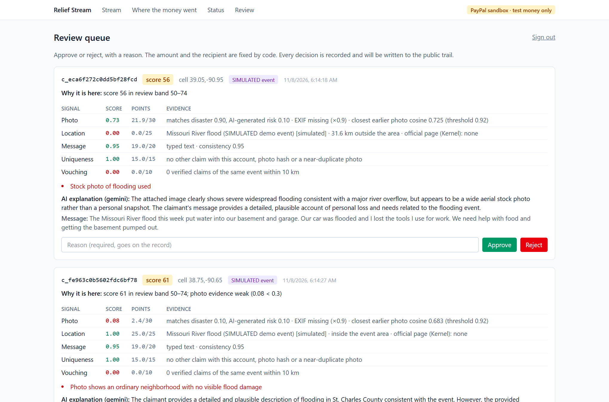
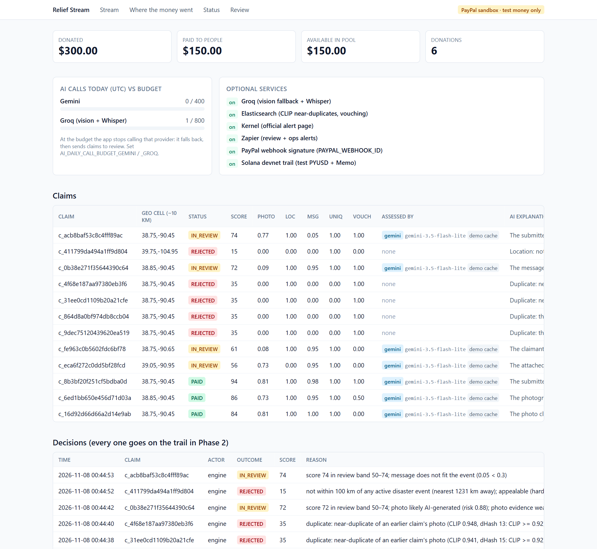
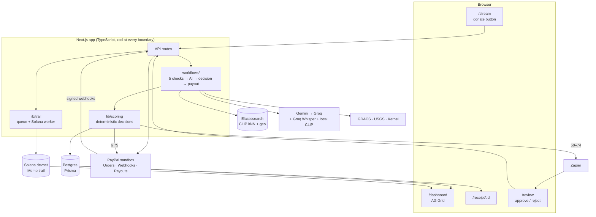

<div align="center">

# Relief Stream

### Charity-stream money, paid **directly** to verified people in a disaster zone, with a public receipt that shows where every dollar went.

<sub>Built for the **PayPal "Build What's Next with PayPal and AI"** hackathon · PayPal **sandbox** and Solana **devnet** only (test money) · runs locally for **$0**</sub>

<br/>

&nbsp;&nbsp;
&nbsp;&nbsp;
&nbsp;&nbsp;
&nbsp;&nbsp;
&nbsp;&nbsp;
&nbsp;&nbsp;
&nbsp;&nbsp;


<br/><br/>



**[The idea](#the-idea) · [How it works](#how-it-works) · [Privacy on-chain](#private-by-design-anonymous-people-public-proof) · [Screenshots](#screenshots) · [Sponsors](#sponsor-tools-and-what-we-built-with-them) · [AI tools](#ai-tools-used) · [Architecture](#architecture) · [Run it](#run-in-10-minutes)**

</div>

---

## The idea

A streamer goes live during a disaster. Chat gets emotional, viewers donate, and a big number scrolls across the screen. Then it goes quiet.

> **Where did that money go? Who actually received it? Did it reach the people it was raised for, or did it disappear into an NGO, a middleman, or a fee?**

Donors never find out. There is no preview of where the money lands, and no way to check.

**Relief Stream fixes the whole path, in three promises:**

| | Promise | How |
| --- | --- | --- |
| | **It lands with the right people** | AI agents verify every person asking for help (location, photo, message, uniqueness, community vouching). Fakes are stopped by the code that moves the money. |
| | **No middleman** | Donations sit in one PayPal pool. Verified people are paid **directly** with PayPal Payouts. Reviewers can approve or reject; they can never change an amount or a recipient. |
| | **Anyone can check, and nobody is exposed** | Every donation, decision and payout is written to a public **Solana** trail using **anonymous ids only**. Each donor gets a receipt: *"your $25 → claim 8B3B, Missouri River flood, verified 06:14, paid"*. |

**The test for every feature:** if we removed the AI, would it stop working? If not, the AI is decoration. Here the AI judges evidence a human would otherwise have to read, and **plain TypeScript decides the money**.

---

## How it works



1. **Donate.** Viewers donate with the PayPal button (Orders v2). Every donation lands in one relief pool.
2. **Claim.** Someone in the disaster zone submits GPS, a photo, a typed message and/or a **voice note**, and their PayPal email.
3. **Five checks run in parallel:**
   - **location** against live GDACS/USGS disaster areas, plus an official alert page read by a Kernel cloud browser;
   - **photo**: EXIF, and near-duplicate search with multi-crop CLIP and a perceptual hash;
   - **voice note**: transcribed by Groq Whisper;
   - **uniqueness**: same PayPal account, same photo, or a near-duplicate;
   - **community vouching**: approved claims of the same event within 10 km.
4. **One AI call per claim** scores whether the photo shows damage that matches the disaster, whether it looks AI-generated, and whether the story fits the event.
5. **Plain TypeScript decides** (`lib/scoring`): **≥ 75** is paid automatically, **50–74** goes to a human reviewer, **< 50** is rejected.
   - **Rejected outright:** fraud the code can prove (duplicate account, reused or edited photo, a location nowhere near a disaster).
   - **Never paid automatically, sent to a human:** problems an AI only *judges* (a photo that looks AI-generated, a story that contradicts the event).
6. **Pay.** PayPal Payouts sends the money straight to the verified person. Each payout is matched FIFO (oldest donations first) to the donations that funded it.
7. **Prove.** The decision and payout go on the public Solana trail. Donors open their receipt and follow the money.

### What the demo catches

There are 12 fixture claims: 3 genuine, 2 borderline and **7 planted fakes**. Each fake must be stopped by the *right* check (verified on every demo run):

| Fake | Caught by | Outcome |
| --- | --- | --- |
| Same photo again, another account | photo SHA-256 | REJECTED |
| Second claim from one PayPal account | account match | REJECTED |
| Cropped + re-compressed copy of a photo | multi-crop CLIP (0.941) + dHash | REJECTED |
| Heavy edit (crop + resize + brightness) | multi-crop CLIP (0.948) | REJECTED |
| AI-generated flood photo | Gemini AI-generated risk + evidence floor | IN_REVIEW (a human decides) |
| Claimant 1,200 km from any disaster | location rule (> 100 km from every active event) | REJECTED |
| Voice note about another disaster | Whisper → message check + evidence floor | IN_REVIEW |

---

## Private by design: anonymous people, public proof

A public trail is only useful if it can't hurt the people in it. Relief Stream puts **proof** on-chain and **identity** nowhere public.

| Public (dashboard, receipts, Solana) | Never public or on-chain |
| --- | --- |
| `claim_id = HMAC(secret salt, PayPal email)`, a one-way anonymous id | names, emails, phone numbers |
| location rounded to a **~10 km grid** | exact GPS |
| amounts, scores, decisions, timestamps | photos and voice notes (deleted once the claim is decided) |
| SHA-256 hash of each record, so anyone can recompute it | voice transcripts, reviewer reasons (stored only as a hash) |

**Every event becomes one tiny Solana devnet transaction with a Memo:**

```
RS|v1|<type>|<anonymous_id>|<amount_usd>|<sha256 of the record>
RS|v1|payout|c_16d92d66d66a2d14e9ab|50.00|4eb8609f57914dfcac146f7f81c17f8e3075dcc9009c37e88f9c7e2c5c90fdc7
```

The record behind each hash is published at `/api/trail`, so **anyone can recompute the hash and confirm nothing was changed**, without learning who anyone is.

**A real chain from this build** (Solana devnet, finalized; memo-only, no PYUSD token transfer yet):

| Step | Explorer |
| --- | --- |
| Donation ($10) | [`62xcMvyD…GZo1`](https://explorer.solana.com/tx/62xcMvyDnhyTDLxaatfuAFwLBKiRBc37VsLp7JLE6ftvXPYE3suX1Pe5jLrk31jLVia5A4FtPLVcw6X3XaKdGZo1?cluster=devnet) |
| Decision: approved (score 84) | [`3uRfJatg…xji8r`](https://explorer.solana.com/tx/3uRfJatg45eMiwJkv5mJYB8RqiAUEaZBTx82XQvBd9w7CHzbZQEUz6NxSi9yVQFLNqCyyJdTMwTxYkwaAZxrji8r?cluster=devnet) |
| Payout ($50 via PayPal) | [`4SbH65BS…ihQx4g`](https://explorer.solana.com/tx/4SbH65BSCQnTKVvnHpKNmqBbgPbNarnvP5sGWfhgVbYAwZEq6xjJU5x4ic5eLUnstywd8xb2bfRyNtEoH4ihQx4g?cluster=devnet) |

---

## Screenshots

### 1. The stream page: viewers donate with PayPal, the pool fills live


### 2. The public dashboard: every dollar accounted for (AG Grid)
Payouts show which donations funded them, the PayPal batch and the Solana link.


### 3. The donor receipt: "your $75 → claim 8B3B, verified, paid"
Each step links to its Solana transaction.


### 4. The reviewer screen: humans decide the borderline cases, never the amount
Every signal with its evidence, the AI's explanation and red flags. Approve or reject needs a written reason, and the decision goes on the public trail.


### 5. The status page: scores, what caught each fake, AI budget, services
Per-signal scores for all 12 claims, the AI daily budget, and which optional services are on.


<sub>Regenerate with `npm run demo` then `npm run screenshots` (uses your installed Chrome or Edge).</sub>

---

## Sponsor tools and what we built with them

| | Sponsor | What we built with it | Where |
| :-: | --- | --- | --- |
|  | **PayPal** | The whole money loop: **Orders v2** + JS SDK donate button into one pool; **Webhooks** (signature-verified, de-duplicated) confirm captures and payouts; **Payouts API** pays verified people directly, with an idempotent `sender_batch_id` per claim and attempt. | `lib/paypal/*`, `app/stream`, `app/api/webhooks/paypal` |
|  | **Solana devnet + test PYUSD** | The public trail: one transaction with a Memo per donation, decision and payout (Token-2022 test-PYUSD transfer when the wallet holds it, memo-only otherwise), with retries that never duplicate. | `lib/trail/*` |
|  | **Elastic** | A photo index with **CLIP vectors** (kNN search finds reused and edited photos, 7 crops per photo) and a claims index with **geo queries** for community vouching. | `lib/search/*` |
|  | **Render** | **Blueprint** (`render.yaml`) for a free web service sized to 512 MB (measured 416 MB), plus **Render Workflows** tasks (five parallel checks, payout, release) with an inline fallback. | `render.yaml`, `workflows/render.ts` |
|  | **Kernel** | A cloud browser opens the official NWS alert page, which has no API, to corroborate the location. A replay link is saved for the demo. | `lib/disasters/kernel.ts` |
|  | **Zapier** | Two Catch Hooks: a **reviewer alert** when a claim lands in the 50–74 band, and **ops alerts** (pool low, payout failed, AI down). | `lib/alerts/*` |
|  | **Postman** | A collection for every internal and PayPal call, run in CI-style with **Newman**: 22 requests, 40 assertions. | `postman/`, `npm run test:api` |
| <b>AG&nbsp;Grid</b> | **AG Grid** | The public transparency dashboard: payouts, decisions, donations, claims and on-chain records, with sorting, filtering and explorer links. | `app/dashboard` |
|  | **Claude Code** (Anthropic) | Pair-programmed the code, tests, project skills and docs under the rules in `CLAUDE.md` and `harness.md`. | `.claude/skills/`, the repo |

<sub>APIMatic's Context Plugin was **not** used: PayPal field names were checked against PayPal's official docs and OpenAPI specs instead.</sub>

---

## AI tools used

| Tool | Where | What it does |
| --- | --- | --- |
| **Google Gemini Flash-Lite** (`gemini-3.5-flash-lite`) | `lib/ai` | One vision + text call per claim: does the photo show damage matching the disaster, does it look AI-generated, does the story fit. Returns red flags and an explanation for reviewers. JSON checked with zod. **It never decides or moves money.** |
| **Groq** vision (`qwen/qwen3.8-27b`) | `lib/ai` | Fallback when Gemini is rate-limited, down or over its daily budget. Same request, same contract. |
| **Groq Whisper** (`whisper-large-v3-turbo`) | `lib/speech` | Voice note → text and language. The transcript stays private. |
| **CLIP** (`Xenova/clip-vit-base-patch32`, ONNX on CPU,  transformers.js) | `lib/vision` | Image embeddings for near-duplicate photos, 7 crops per photo. Runs locally: no API, no quota. |
| **Claude Code** (Anthropic) | the repo | Coding assistant for the whole project (see above). |

**AI is one call per claim, and it is budgeted:** daily budgets (Gemini 400, Groq 800) are counted in Postgres. At the limit the app falls back to the other provider, or sends the claim to a human. A failure of the AI **never** auto-rejects and **never** auto-pays.

---

## Architecture



**Design rules the code enforces**

- **Money decisions are code, not AI.** `lib/scoring` decides and sizes payouts. Only `workflows/send-payout.ts` calls Payouts, and only after an `APPROVED` decision.
- **Reviewers can't change amounts or recipients.** The review API accepts `{action, reason}` only. The reason is stored as a hash.
- **Privacy:** HMAC ids, a ~10 km public grid, photos and voice notes deleted once the claim is decided, no email on any public page, alert or on-chain record.
- **Sandbox and devnet only:** the PayPal client refuses non-sandbox URLs, and the trail refuses non-devnet RPCs.
- **Idempotent and recoverable:** `PayPal-Request-Id`, a unique `sender_batch_id` per claim and attempt, webhooks de-duplicated by event id, one trail entry per event, and a recovery sweep that re-runs stuck claims without ever deciding or paying twice.
- **Graceful degradation:** only PayPal sandbox, Gemini and Postgres are required. Every other service switches off cleanly.

Full design, data model, scoring rules and sequence diagrams: **[architecture.md](architecture.md)** · Plan and rules: [harness.md](harness.md)

### Code map

| Path | What lives here |
| --- | --- |
| `app/` | Next.js App Router pages: `stream`, `dashboard`, `receipt/[id]`, `review`, `admin`, and every API route |
| `lib/paypal/` | OAuth token, Orders v2, Payouts, webhook signature verification |
| `lib/scoring/` | The five weights, thresholds, hard rules and packet sizing. Pure functions, fully unit-tested |
| `lib/ai/` | The only LLM entry point: Gemini → Groq fallback, zod contract, daily budget, demo cache |
| `lib/vision/` | EXIF, SHA-256, dHash, CLIP embeddings (multi-crop) |
| `lib/search/` | Elasticsearch client: photo kNN and claims geo queries |
| `lib/speech/` | Whisper wrapper (Groq or local) |
| `lib/disasters/` | GDACS + USGS areas, the simulated demo flood, Kernel alert-page check |
| `lib/trail/` | Trail queue, memo format, Solana worker, explorer links |
| `lib/privacy/` | HMAC ids, geo rounding, redaction |
| `lib/alerts/` | Zapier hooks |
| `lib/claims/` | Evidence store (until the decision), recovery sweep, operator report |
| `workflows/` | The five checks, verify-claim, send-payout, dispatch (inline or Render Workflows) |
| `simulators/` | Stream + claim scripts, fixtures including the planted fakes, the one-command demo |
| `prisma/` | Schema and migrations |
| `postman/` | Collection and environments |
| `scripts/` | `setup`, `dev-local`, `check-env`, `tunnel`, robustness, e2e, screenshots |
| `tests/` | 127 unit tests (vitest) |
| `.claude/skills/` | Project skills used while building |

**Stack:** TypeScript · Next.js 16 · Prisma 7 + Postgres 17 · Elasticsearch 9.5 · AG Grid Community · `@solana/web3.js` + `@solana/spl-token` · `@google/genai` · transformers.js (ONNX) · zod · vitest · Playwright · Newman · Docker.

---

## Run in 10 minutes

**You need:** Node 20+ (tested on 24), **Docker Desktop** (free), a **PayPal developer account** (free; sandbox) and a **Gemini API key** (free, [aistudio.google.com](https://aistudio.google.com)). Nothing else is required.

```bash
git clone https://github.com/Aryan27-max/Pay-Pal-Ai-Hackathon.git && cd Pay-Pal-Ai-Hackathon
npm run setup                 # 1st run: installs, creates .env, lists the keys to add, and stops
# put your PayPal sandbox + Gemini keys in .env (table below), then:
npm run setup                 # 2nd run: starts local Postgres + Elasticsearch in Docker, migrates, creates
                              # the indices, downloads the CLIP model (~90 MB) and seeds
npm run check:env -- --core   # checks only what you need: PayPal sandbox, Gemini, Postgres
npm run dev:local             # http://localhost:3000
npm run demo                  # in a second terminal: the scripted demo (≈ 4 min), prints receipt links
```

Then open **http://localhost:3000/dashboard** (where the money went), a receipt link printed by the demo, **/review** (the reviewer queue; it needs `REVIEWER_ACCESS_TOKEN`) and **/admin** (status, AI budget, services).

### Keys
| Needed? | Keys | Where |
| --- | --- | --- |
| **Core** | `PAYPAL_CLIENT_ID`, `PAYPAL_CLIENT_SECRET`, `NEXT_PUBLIC_PAYPAL_CLIENT_ID` (same value), `PAYPAL_POOL_BUSINESS_EMAIL` | developer.paypal.com → Apps & Credentials → **Sandbox** (setup below) |
| **Core** | `SIM_DONOR_EMAILS` (3), `SIM_CLAIMANT_EMAILS` (6) | developer.paypal.com → Testing Tools → Sandbox Accounts (US Personal) |
| **Core** | `GEMINI_API_KEY` | aistudio.google.com → Get API key (free) |
| Auto | `CLAIM_ID_SALT`, `REVIEWER_ACCESS_TOKEN` | generated by `npm run setup` if empty. To open /review, copy `REVIEWER_ACCESS_TOKEN` from your `.env` |
| Optional | `GROQ_API_KEY` | console.groq.com (free): AI fallback + voice notes |
| Optional | `KERNEL_API_KEY` | dashboard.onkernel.com (free Developer plan): official alert-page check |
| Optional | `ZAPIER_REVIEW_WEBHOOK_URL`, `ZAPIER_ALERT_WEBHOOK_URL` | two Zapier Catch Hooks (free plan) |
| Optional | `SOLANA_TRAIL_WALLET_SECRET_KEY` (+ RPC, mint, explorer defaults) | any devnet wallet; fund it at faucet.solana.com (free) |
| Optional | `PAYPAL_WEBHOOK_ID` | after `npm run tunnel` (below) |

`DATABASE_URL` and `ELASTIC_URL` already point to the local containers.

**What happens when an optional key is missing.** `/admin` and `check:env` show the service as "disabled: no key"; nothing crashes:

| Missing key | Effect |
| --- | --- |
| Groq | No AI fallback (a Gemini failure sends the claim to review); voice notes aren't transcribed. |
| Kernel | Location uses the feeds only. |
| Zapier | No alerts. Use the /review queue. |
| Solana | No on-chain records. Payouts are unaffected. |

### PayPal sandbox setup
**Use US sandbox accounts** for the app, the pool business account, donors and claimants. PayPal hasn't supported domestic India-to-India payments since April 2021, and Advanced Credit and Debit Card payments aren't available to India accounts. Everything is in USD.

1. developer.paypal.com → **Apps & Credentials → Sandbox** → create an app. Put its client id and secret in `.env`. The app's business account **is the relief pool**: set `PAYPAL_POOL_BUSINESS_EMAIL` to its email. `npm run paypal:smoke` checks that orders land there.
2. **Testing Tools → Sandbox Accounts**: create US personal accounts, 3 donors (`SIM_DONOR_EMAILS`) and 6 claimants (`SIM_CLAIMANT_EMAILS`), comma-separated.
3. For the scripted donations, enable **Advanced Credit and Debit Card Payments** on the sandbox app. The simulator pays with a PayPal sandbox test card.

### PayPal webhooks and the PayPal button, through a free tunnel
`npm run tunnel` opens a **Cloudflare quick tunnel** (free, no account) to your local app and prints the steps:
- add `<tunnel-url>/api/webhooks/paypal` as a sandbox webhook (capture completed, payout item succeeded / failed / unclaimed). **The path must be exactly `/api/webhooks/paypal`**;
- copy its id into `PAYPAL_WEBHOOK_ID`, then restart `npm run dev:local`.

The tunnel URL changes every time, so register the webhook again each time. Without a webhook the app still works: payouts are settled by polling.

### Commands
| Command | What it does |
| --- | --- |
| `npm run setup` | One-time setup (Docker stack, migrations, indices, CLIP model, seed) |
| `npm run dev:local` | Local stack + Next.js on :3000 |
| `npm run demo -- --runs 3` | Scripted demo, run N times. Each run: donations → 12 claims → second donation wave → payouts → public trail → checks. Prints signals, decisions, which check caught each fake, PayPal ids, Solana links, receipt links, and AI calls vs budget. **It resets demo data at the start of each run.** |
| `npm run check:env` / `-- --core` | Every key SET/MISSING/SKIP per phase, plus cheap live checks (values are never printed) |
| `npm test` · `npm run typecheck` | 127 unit tests (vitest) · `tsc --noEmit` |
| `npm run test:e2e` | Reviewer flow in a real browser (Playwright; uses your Chrome or Edge) |
| `npm run test:api` | Postman collection via Newman against the local app |
| `npm run check:robustness` | Live race + recovery proofs |
| `npm run screenshots` | Regenerates the README images in `docs/screenshots` |
| `npm run tunnel` | Free public HTTPS URL for PayPal webhooks |
| `npm run clip:tune` · `npm run disasters:live` · `npm run alerts:test -- review\|ops` | Photo-similarity matrix · real GDACS/USGS lookup · one test alert |
| `npm run sim:reset -- --yes` · `npm run stack:down` | Wipe demo data · stop the containers |

---

## Zero-cost design

- **Local first:** Postgres and Elasticsearch run in Docker, CLIP runs on your CPU, and the tunnel is a free Cloudflare quick tunnel.
- **Free AI tiers only:**
  - **Daily budget:** the `AI_DAILY_CALL_BUDGET_GEMINI` (400) and `_GROQ` (800) guards are counted in Postgres. At the budget the app falls back to the other provider, or sends the claim to review with the reason.
  - **Demo cache:** the scripted demo reuses validated results for its fixture claims only (`AI_DEMO_CACHE`, on in development), so repeating it costs no AI calls. Real claims always call the AI.
- **Graceful degradation:** only PayPal sandbox, Gemini and Postgres are required.
- **No paid hosting needed** to try it: judges run it locally with the commands above.

## Deployment (free hosting)
The app also runs hosted on **free tiers only**: **one free Render web service** (the `render.yaml` Blueprint) plus **Neon's free Postgres**.
- **Memory:** Render's free instance has **512 MB**. We measured the production server (`next build && next start`) at **416 MB peak** after four claims, with CLIP loaded lazily as q4 weights, a lean ONNX session and `NODE_OPTIONS=--max-old-space-size=192` (all set in `render.yaml`; q8 peaked at 538 MB). If the host ever runs out of memory, `CLIP_MODE=off` skips the model and uses the perceptual hash only.
- **Database:** Render's free Postgres is deleted after 30 days, so use **Neon** (permanent, no card). Supabase is untested: its free projects pause after 7 days without activity, and its pooler certificate may fail our strict TLS check. The Render build runs `prisma migrate deploy`.
- **No Elasticsearch needed:** with `ELASTIC_URL` empty, the multi-crop CLIP embeddings are stored and compared in **Postgres** with the same rule, and vouching also uses Postgres, so the cropped and heavy-edit fakes are still caught.
- **Cold starts:** the free service sleeps after 15 minutes idle and takes about a minute to wake. The first claim after a wake-up also loads CLIP, which takes 17 s locally and longer on the free plan's shared CPU.
- **Webhooks:** register `<your-render-url>/api/webhooks/paypal` and set `PAYPAL_WEBHOOK_ID`.
- **Not used for hosting:** Vercel, because it is serverless (no background trail or recovery loops) and the CLIP runtime is over its function size limit. Railway, because it has no ongoing free plan.

---

## What we tested

| Check | Result |
| --- | --- |
| Scripted demo, 3 runs in a row | 3/3: all 7 fakes caught by their intended check, all 3 genuine claims paid |
| Unit tests · typecheck | 127/127 · clean |
| Reviewer flow in a real browser | passes (approval + rejection recorded with actor and reason; only the approved claim is paid) |
| Postman via Newman | 22 requests, 40 assertions, 0 failures |
| Race + crash recovery | a photo and its resized copy sent together → exactly one rejected; a stuck claim is decided exactly once |
| Solana trail | 21 records confirmed on devnet |
| PayPal webhooks | signed payout events verified; a duplicate delivery is ignored; an unsigned event is rejected with 400 |
| Fresh clone, core keys only | `setup` → `check:env -- --core` → `dev:local` → `demo` passes |
| Secret scan of every file and the full git history | no secrets; `.env` never committed |

## Known limits
- **Solana trail:** needs a devnet wallet funded at faucet.solana.com. Records are written **memo-only** unless the wallet also holds test PYUSD.
- A heavy edit can get past the near-duplicate check when CLIP places it near other flood photos (measured; see architecture.md §5).
- The disaster areas come from GDACS polygons or radius heuristics. Kernel reads one official page (NWS, US only).
- In dev mode, the first page you open after starting the server may reload a few times while it compiles. Seen in a OneDrive-synced folder.
- Test money only. A real deployment needs PayPal production approval, Enterprise Payouts for PYUSD, and a privacy review.

## Credits
Demo claim photos are public-domain FEMA images and one public-domain AI-generated image from Wikimedia Commons. The cropped and heavy-edit fakes are derived from one of them. The contradicting voice note is self-made with Windows text-to-speech. Brand logos are from [Simple Icons](https://simpleicons.org) (CC0) and the companies' own sites; they belong to their owners. See [simulators/fixtures/photos/CREDITS.md](simulators/fixtures/photos/CREDITS.md) and [simulators/fixtures/audio/README.md](simulators/fixtures/audio/README.md).

## License
[MIT](LICENSE)
