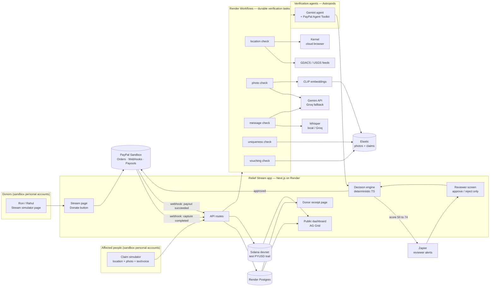
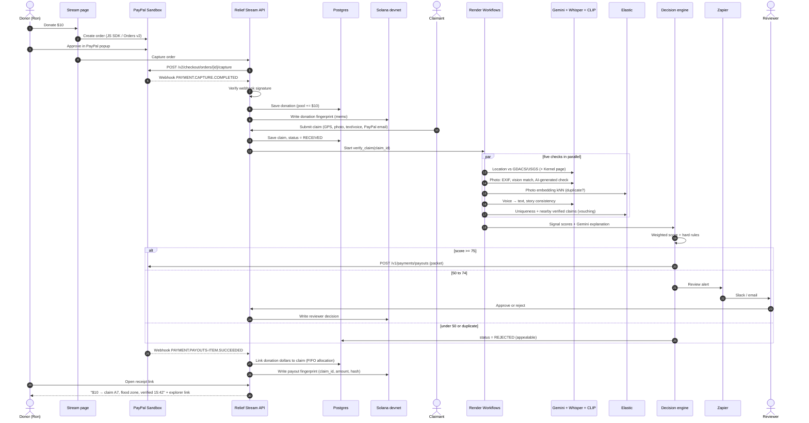
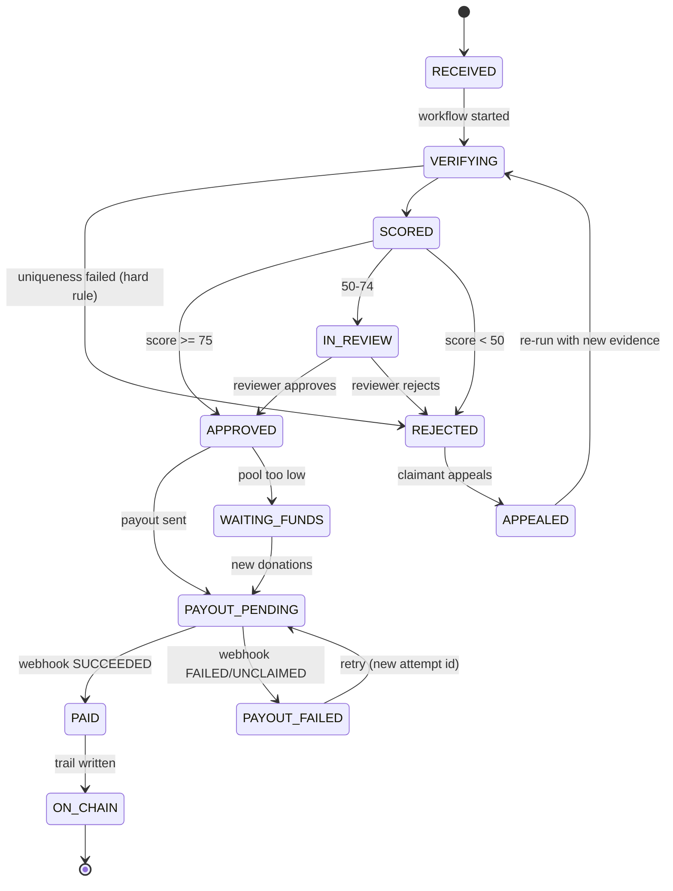
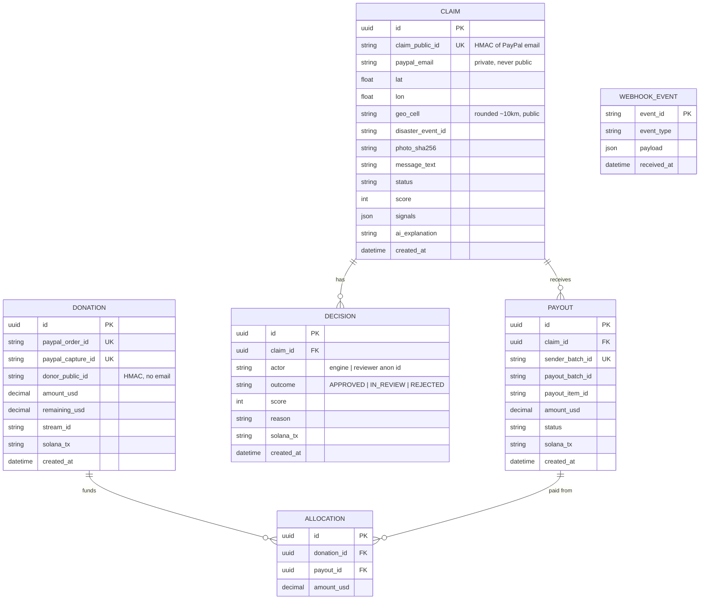

# architecture.md — Relief Stream system design

**This file is a harness.** It is the single source of truth for how Relief Stream is built. Before writing code, check that the change fits this design. If the design must change, update this file (and its diagrams) in the same change. Read it together with `harness.md`, `CLAUDE.md` and `SKILL.md`.

## 1. System overview



## 2. End-to-end sequence



## 3. Claim lifecycle



## 4. Data model



**Allocation:** when a payout succeeds, its amount is matched to the oldest donations with `remaining_usd > 0` (FIFO). That is what lets a donor's receipt name the exact claims their money reached.

**Implementation notes (Phase 1):**

- `claim_public_id = HMAC(CLAIM_ID_SALT, paypal_email)` for an account's first claim. A repeat claim from the same account uses `HMAC(salt, email#n)`, so it can still be stored (and rejected as a duplicate) without breaking the unique key.
- Extra columns: `Donation.source` (`paypal_button` | `sim_card`), `Claim.updated_at`, `Claim.ai_provider` (`gemini` | `groq` | null), `Claim.ai_model`, `Claim.ai_cached`, `Payout.attempt`, `Payout.error`, `Payout.updated_at`.
- Table `ai_cache` (demo cache, §5) holds validated AI scores for fixture claims only: key, provider, model, photo/message hashes, prompt version and the assessment JSON. It is not demo data, so `sim:reset` keeps it. It never stores photos, messages or emails.
- `sender_batch_id = <claim_public_id>-<claim row tag>-<attempt>`, where the row tag is the first 8 hex of the claim's uuid (e.g. `c_16d92d66d66a2d14e9ab-3f2a9c1e-1`). It is "claim id + attempt" (harness §5.7) keyed on the claim **record**. **Why:** `claim_public_id` is an HMAC of the email, so after a demo reset a *new* claim from the same sandbox account got the same id, and PayPal answered `400 USER_BUSINESS_ERROR` because it refuses a `sender_batch_id` it has seen in the last 30 days (seen live on 2026-11-07). With the row tag, re-sending the same attempt is still idempotent, but a new claim can never collide with an old paid batch.
- Photos are **not stored**, only `photo_sha256`. The bytes go to the AI once, during verification (to Gemini, or to Groq if Gemini fails).
- **Pool balance** = Σ `donation.remaining_usd` − Σ payouts still in flight (`CREATED`, `PENDING`, `PROCESSING`, `ONHOLD`, `UNCLAIMED`). Reservation and FIFO settlement both run under a Postgres advisory lock.

## 5. Verification scoring

Each check returns a sub-score from 0 to 1. The engine multiplies by the weights in `.env`.

| Signal | Weight | Passes when | Tools |
| --- | --- | --- | --- |
| Photo | 30 | EXIF time/place plausible; vision model confirms damage matches the disaster type; not flagged as AI-generated; not a near-duplicate | Gemini vision, exifr, CLIP + Elastic kNN |
| Location | 25 | GPS inside an active GDACS/USGS event area (or confirmed on an official alert page) | GDACS, USGS, Kernel |
| Message | 20 | Text or transcribed voice matches event, place and language; no copy-paste template | Whisper, Gemini |
| Uniqueness | 15 | No other claim with the same PayPal account, device ID or photo hash | Postgres, Elastic |
| Community vouching | 10 | Other already-verified claims nearby in the same event (or a verified claimant vouches) | Elastic geo query |

**Hard rules (code, not AI):**

- Uniqueness = 0 → `REJECTED`, whatever the total.
- Total ≥ `AUTO_PAYOUT_THRESHOLD` (75) → `APPROVED`.
- `HUMAN_REVIEW_THRESHOLD` (50) ≤ total < 75 → `IN_REVIEW`.
- Total < 50 → `REJECTED` (appealable).
- Packet = `DEFAULT_PACKET_USD`, never above `MAX_FIRST_PACKET_USD`, and never above the pool balance.
- If the pool can't cover a full packet, the claim goes to `WAITING_FUNDS` (no partial packets) and is retried when new donations arrive.
- Release order: every recorded donation (button capture, webhook, simulator) runs `retryWaitingFunds`. `lib/scoring.planWaitingFundsRelease` picks waiting claims **strictly oldest first** and stops at the first one the pool can't cover in full. `send-payout` re-checks the decision and pool under the advisory lock before sending.
- No valid AI assessment (Gemini **and** the Groq fallback both failed) → `IN_REVIEW`, and the decision reason says both failed and why, unless the claim is a duplicate (then `REJECTED`). AI failure never auto-rejects.

**Phase 1 signal details:**

- Photo = `photo_matches_disaster × (1 − photo_ai_generated_risk)`; message = `message_consistency`.
- Location uses one fixed demo zone (`simulators/fixtures/flood-zone.json`): inside the radius → 1, inside radius + buffer → 0.5, else 0. Location is **not** sent to Gemini (no double counting).
- Uniqueness = Postgres match on PayPal email or photo SHA-256. Duplicates skip the Gemini call.
- Vouching = verified claims within 10 km: 1 → 0.5, ≥ 2 → 1.
- Score = `round(Σ weight × signal)`, an integer, so thresholds are exact.

**AI pipeline (`lib/ai`, the only LLM entry point):**

- **One call per claim.** The photo and the message are assessed together in one request against one output contract (below). Duplicates make no call.
- **Provider order:** demo cache (fixture claims only) → **Gemini** `GEMINI_MODEL_VISION` (`gemini-3.5-flash-lite`, free tier) → **Groq** `GROQ_VISION_MODEL` fallback.
  - Gemini policy: bad output gets one retry. A 503, a timeout (45 s) or a per-minute 429 backs off 3 s / 6 s / 12 s (or the given `retryDelay`), then hands over. A per-day quota 429 hands over at once.
  - Groq is called only if Gemini failed, with the same prompt and photo, in JSON mode. Its answer goes through the **same zod contract**.
  - The provider and model that answered are stored on the claim (`ai_provider`, `ai_model`) and shown on `/admin`.
- **Demo cache** (`AI_DEMO_CACHE` = `on` | `off`; empty means on in development and off in production):
  - Key = sha256(photo SHA-256 | message SHA-256 | model id | prompt version). A prompt or model change therefore misses the cache.
  - Only claims whose photo bytes **and** message both match a fixture in `simulators/fixtures/claims.json` may read or write it. The server decides that from content hashes, never from a client flag, so real claims always call the AI.
  - Only validated results are stored.
- **Why free tiers:** the hackathon build runs on free quotas only. Flash-Lite allows ~500 requests a day per project (20 for Flash), and Groq's free tier adds a second, independent quota. Together with the demo cache, the demo can't be pushed into review by a quota error.
- **Prompt rule:** each field is scored on its own evidence. A photo/message mismatch lowers the photo score and adds a red flag, but doesn't also lower `message_consistency` (no double counting).

**AI output contract** (Gemini and Groq; validated with zod; invalid output = retry, then fallback, then `IN_REVIEW`):

```json
{
  "photo_matches_disaster": 0.0,
  "photo_ai_generated_risk": 0.0,
  "message_consistency": 0.0,
  "language_detected": "hi",
  "red_flags": ["string"],
  "explanation": "One short paragraph a reviewer can read."
}
```

## 6. Public transparency trail

- **Network:** Solana devnet. **Token:** test PYUSD from the Google Cloud faucet (`PYUSD_DEVNET_MINT`).
- For each event (donation, decision, payout) we send a tiny test-PYUSD transfer from the trail wallet with a **Memo** instruction:
  `RS|v1|<type>|<public_id>|<amount_usd>|<sha256 of the DB row>`
- **Never on-chain:** names, emails, photos, phone numbers, exact GPS.
- Real money moves only through PayPal Payouts. The chain is the public, tamper-evident record. (Self-serve Payouts cannot send PYUSD in sandbox; production would use Enterprise Payouts.)

## 7. API surface (Next.js route handlers)

| Method | Path | Purpose |
| --- | --- | --- |
| POST | `/api/donations/create-order` | Create PayPal order for the stream donate button |
| POST | `/api/donations/capture` | Capture an approved order |
| POST | `/api/webhooks/paypal` | Verify signature; handle capture + payout events |
| POST | `/api/claims` | Submit a claim (multipart: photo, audio, fields) |
| GET | `/api/claims/:publicId` | Public, redacted claim status |
| POST | `/api/review/:claimId` | Reviewer approve/reject (token required) |
| GET | `/api/trail` | Public feed for the AG Grid dashboard |
| GET | `/api/receipts/:donorPublicId` | Donor receipt: where each dollar went |
| GET | `/api/pool` | Public pool totals + recent anonymous donations (stream page) |
| GET | `/api/review` | Reviewer queue of `IN_REVIEW` claims (token required) |
| POST | `/api/payouts/sync` | Re-poll pending payouts and settle the final ones (operator token) |
| POST | `/api/sim/stream` | Demo: scripted donations paid with a sandbox test card (operator token) |
| POST | `/api/sim/claims` | Demo: fire scripted claims (Phase 3; Phase 1 uses `npm run sim:claims`, which posts to `/api/claims`) |

In Phase 1, `POST /api/claims` runs `workflows/verify-claim.ts` inline and calls `workflows/send-payout.ts` only on an `APPROVED` decision. Phase 2 moves both into Render Workflows tasks without changing their logic.

## 8. Repo layout

```text
relief-stream/
├── CLAUDE.md  harness.md  architecture.md  SKILL.md
├── .claude/skills/<skill-name>/SKILL.md
├── app/                      # Next.js App Router pages + API routes
│   ├── stream/  dashboard/  receipt/[id]/  review/
│   └── api/...
├── lib/
│   ├── paypal/               # oauth, orders, webhooks, payouts, agent-toolkit tools
│   ├── ai/                   # single AI entry point: Gemini → Groq fallback, demo cache
│   ├── speech/               # Whisper wrapper (local | groq)
│   ├── vision/               # EXIF, CLIP embeddings
│   ├── search/               # Elastic client + queries
│   ├── disasters/            # GDACS, USGS, Kernel checks
│   ├── scoring/              # weights, hard rules, decision engine
│   ├── trail/                # Solana memo + test PYUSD
│   ├── alerts/               # Zapier hooks
│   ├── privacy/              # HMAC ids, geo rounding, redaction
│   ├── db.ts  env.ts  http.ts # Prisma client, zod env, route helpers
│   └── ledger.ts             # pool balance, donations, FIFO settlement
├── workflows/                # Render Workflows tasks (verify_claim, payout, write_trail)
├── agents/                   # Astropods agent (astropods.yml, Dockerfile)
├── simulators/               # stream + claim scripts and fixtures (incl. planted fakes)
├── prisma/schema.prisma  prisma.config.ts  prisma/migrations/
├── scripts/                  # check-env.ts, paypal-smoke.ts
├── tests/                    # vitest unit tests
├── postman/relief-stream.postman_collection.json
├── graphify-out/             # graph.json, GRAPH_REPORT.md
├── .env.example  .gitignore  LICENSE  README.md
```

## 9. Tech stack

| Area | Choice |
| --- | --- |
| Language / framework | TypeScript, Next.js (App Router), Tailwind |
| Database / ORM | Render Postgres, Prisma |
| Durable jobs | Render Workflows (TS SDK) |
| Payments | PayPal JS SDK, Orders v2, Webhooks, Payouts v1, `@paypal/agent-toolkit` |
| LLM + vision | Gemini Flash-Lite via `@google/genai`; Groq vision model fallback (OpenAI-compatible REST) |
| Speech | Whisper (faster-whisper locally) / Groq API |
| Image similarity | CLIP embeddings → Elastic dense_vector kNN |
| Search | Elastic Cloud (`@elastic/elasticsearch`) |
| Browser agent | Kernel SDK (`@onkernel/sdk`) + Playwright |
| Agent runtime / monitoring | Astropods |
| Chain | `@solana/web3.js`, `@solana/spl-token`, Memo program, devnet |
| Dashboard | AG Grid (React) |
| Alerts | Zapier Catch Hooks |
| API testing | Postman |
| Coding context | APIMatic Context Plugin |
| Validation / tests | zod, vitest |
