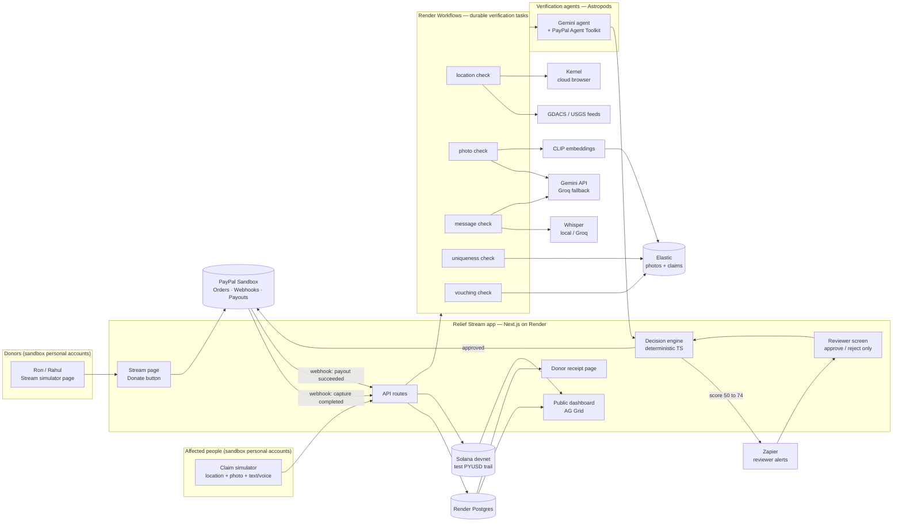
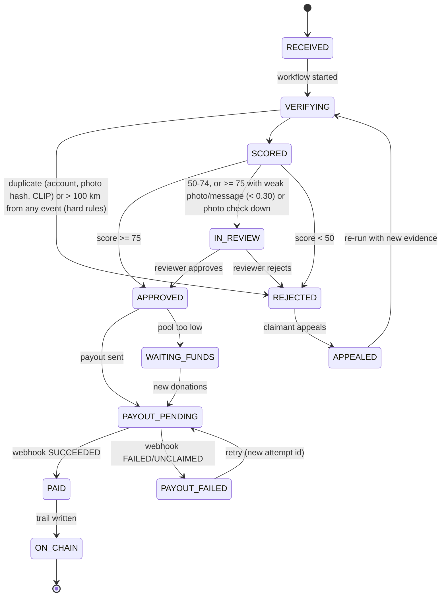
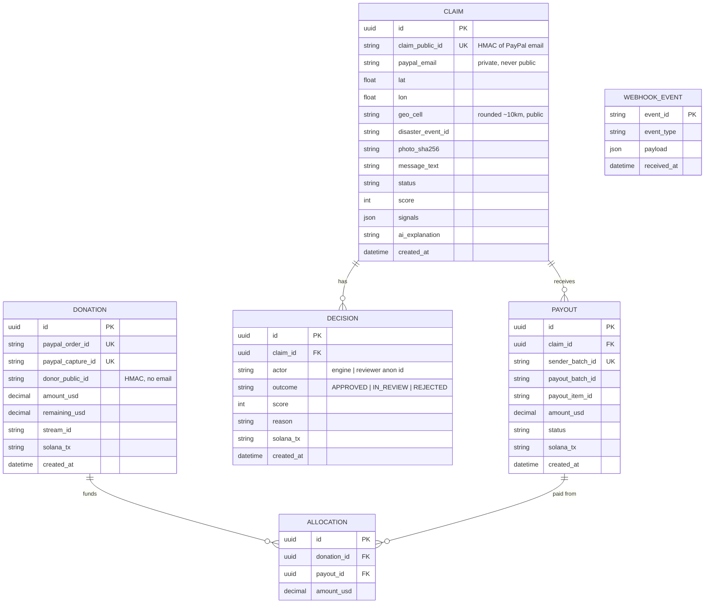

# architecture.md — Relief Stream system design

**This file is a harness.** It is the single source of truth for how Relief Stream is built. Before writing code, check that the change fits this design. If the design must change, update this file (and its diagrams) in the same change. Read it together with `harness.md`, `CLAUDE.md` and `SKILL.md`.

## 1. System overview



## 2. End-to-end sequence

```mermaid
sequenceDiagram
    autonumber
    actor Donor as Donor (Ron)
    participant Web as Stream page
    participant PP as PayPal Sandbox
    participant API as Relief Stream API
    participant DB as Postgres
    participant SOL as Solana devnet
    actor Claimant
    participant WF as Render Workflows
    participant AI as Gemini + Whisper + CLIP
    participant ES as Elastic
    participant ENG as Decision engine
    participant ZAP as Zapier
    actor Reviewer

    Donor->>Web: Donate $10
    Web->>PP: Create order (JS SDK / Orders v2)
    Donor->>PP: Approve in PayPal popup
    Web->>API: Capture order
    API->>PP: POST /v2/checkout/orders/{id}/capture
    PP-->>API: Webhook PAYMENT.CAPTURE.COMPLETED
    API->>API: Verify webhook signature
    API->>DB: Save donation (pool += $10)
    API->>SOL: Write donation fingerprint (memo)

    Claimant->>API: Submit claim (GPS, photo, text and/or voice note, PayPal email)
    API->>DB: Save claim (RECEIVED) + evidence bytes (claim_evidence, until the decision)
    API->>WF: startTask verify_claim(claim_id)
    par five checks in parallel (child tasks)
        WF->>WF: Location: GDACS/USGS/SIMULATED areas (+ Kernel official page, 30 s cap)
        WF->>ES: Photo: EXIF + CLIP embedding, kNN near-duplicate, index photo
        WF->>AI: Message: voice note → Whisper transcript (private)
        WF->>DB: Uniqueness: same PayPal account / same photo SHA-256
        WF->>ES: Vouching: approved claims, same event, within 10 km
    end
    WF->>AI: ONE call: photo + typed text + transcript (skipped if duplicate or far from any event)
    WF->>ENG: Signals + AI scores + explanation
    ENG->>ENG: Weighted score + hard rules (lib/scoring)
    WF->>DB: Decision row; evidence deleted

    alt score >= 75 and core evidence ok
        ENG->>PP: send_payout task: POST /v1/payments/payouts (packet)
    else 50 to 74
        ENG->>ZAP: Review alert
        ZAP->>Reviewer: Slack / email
        Reviewer->>API: Approve or reject
        API->>SOL: Write reviewer decision
    else under 50, duplicate, CLIP near-duplicate, or > 100 km from any event
        ENG->>DB: status = REJECTED (appealable)
    end

    PP-->>API: Webhook PAYMENT.PAYOUTS-ITEM.SUCCEEDED
    API->>DB: Link donation dollars to claim (FIFO allocation)
    API->>SOL: Write payout fingerprint (claim_id, amount, hash)
    Donor->>API: Open receipt link
    API-->>Donor: "$10 → claim A7, flood zone, verified 15:42" + explorer link
```

## 3. Claim lifecycle



## 4. Data model



**Allocation:** when a payout succeeds, its amount is matched to the oldest donations with `remaining_usd > 0` (FIFO). That is what lets a donor's receipt name the exact claims their money reached.

**Implementation notes (Phase 1):**

- `claim_public_id = HMAC(CLAIM_ID_SALT, paypal_email)` for an account's first claim. A repeat claim from the same account uses `HMAC(salt, email#n)`, so it can still be stored (and rejected as a duplicate) without breaking the unique key.
- Extra columns: `Donation.source` (`paypal_button` | `sim_card`), `Claim.updated_at`, `Claim.ai_provider` (`gemini` | `groq` | null), `Claim.ai_model`, `Claim.ai_cached`, `Payout.attempt`, `Payout.error`, `Payout.updated_at`.
- Table `ai_cache` (demo cache, §5) holds validated AI scores for fixture claims only: key, provider, model, photo/message hashes, prompt version and the assessment JSON. It is not demo data, so `sim:reset` keeps it. It never stores photos, messages or emails.
- `sender_batch_id = <claim_public_id>-<claim row tag>-<attempt>`, where the row tag is the first 8 hex of the claim's uuid (e.g. `c_16d92d66d66a2d14e9ab-3f2a9c1e-1`). It is "claim id + attempt" (harness §5.7) keyed on the claim **record**. **Why:** `claim_public_id` is an HMAC of the email, so after a demo reset a *new* claim from the same sandbox account got the same id, and PayPal answered `400 USER_BUSINESS_ERROR` because it refuses a `sender_batch_id` it has seen in the last 30 days (seen live on 2026-11-07). With the row tag, re-sending the same attempt is still idempotent, but a new claim can never collide with an old paid batch.
- Photos and voice notes are **held only until the decision**, then deleted (`lib/claims/evidence`). With Render Workflows they sit in `claim_evidence` (bytea) so each task instance can read them by claim id; inline (local dev) they stay in process memory only. **Why not task arguments:** Render retains task inputs for 30 days, and photos must not outlive verification. **Why not Postgres inline:** reading ~0.5 MB back from Render Postgres over the public internet took 15–20 s from a laptop (measured 2026-11-07) and slow transfers were reset.
- Phase 2 columns on `claim`: `audio_sha256`, `transcript` + `transcript_lang` (private, never public), `event_source` (`simulated` | `gdacs` | `usgs`), `kernel_status`, `kernel_replay_url` (private: Kernel says replay links are sensitive; /admin only).
- Table `feed_cache` (key, body, fetched_at): GDACS/USGS responses and Kernel results, shared by all instances, with an in-process memo in front (`lib/cache.ts`). Table `alert_sent` (key, kind): one Zapier alert per key (e.g. `review:<claim_public_id>`, `pool_low:<hour>`).
- Elastic (not Postgres): `relief-photos` = `claim_public_id` + 512-d CLIP vector; `relief-claims` = `claim_public_id`, location rounded to 0.01° (~1 km), `event_id`, `status`, `duplicate`. No PII in either.
- **Pool balance** = Σ `donation.remaining_usd` − Σ payouts still in flight (`CREATED`, `PENDING`, `PROCESSING`, `ONHOLD`, `UNCLAIMED`). Reservation and FIFO settlement both run under a Postgres advisory lock.

## 5. Verification scoring

Each check returns a sub-score from 0 to 1. The engine multiplies by the weights in `.env`.

| Signal | Weight | Passes when | Tools |
| --- | --- | --- | --- |
| Photo | 30 | EXIF time/place plausible; vision model confirms damage matches the disaster type; not flagged as AI-generated; not a near-duplicate | Gemini vision, exifr, CLIP + Elastic kNN |
| Location | 25 | GPS inside an active GDACS/USGS event area (or confirmed on an official alert page) | GDACS, USGS, Kernel |
| Message | 20 | Text or transcribed voice matches event, place and language; no copy-paste template | Whisper, Gemini |
| Uniqueness | 15 | No other claim with the same PayPal account, device ID or photo hash | Postgres, Elastic |
| Community vouching | 10 | Other already-verified claims nearby in the same event (or a verified claimant vouches) | Elastic geo query |

**Hard rules (code, not AI):**

- Uniqueness = 0 → `REJECTED`, whatever the total.
- Total ≥ `AUTO_PAYOUT_THRESHOLD` (75) → `APPROVED`.
- `HUMAN_REVIEW_THRESHOLD` (50) ≤ total < 75 → `IN_REVIEW`.
- Total < 50 → `REJECTED` (appealable).
- Packet = `DEFAULT_PACKET_USD`, never above `MAX_FIRST_PACKET_USD`, and never above the pool balance.
- If the pool can't cover a full packet, the claim goes to `WAITING_FUNDS` (no partial packets) and is retried when new donations arrive.
- Release order: every recorded donation (button capture, webhook, simulator) runs `retryWaitingFunds`. `lib/scoring.planWaitingFundsRelease` picks waiting claims **strictly oldest first** and stops at the first one the pool can't cover in full. `send-payout` re-checks the decision and pool under the advisory lock before sending.
- No valid AI assessment (Gemini **and** the Groq fallback both failed) → `IN_REVIEW`, and the decision reason says both failed and why, unless the claim is a duplicate (then `REJECTED`). AI failure never auto-rejects.

**Signal details (Phase 2):**

- **Photo** = `photo_matches_disaster × (1 − photo_ai_generated_risk) × exif_factor`. EXIF (exifr): plausible → 1.0, **missing → 0.9** (WhatsApp and most upload paths strip it: never a fail), contradicting (taken > 1 day before the event start, in the future, or EXIF GPS > 50 km from the claim) → 0.6.
- **Location** (`lib/disasters`): one code path for every event. GDACS JSON API (events of type FL/TC/EQ/WF/VO whose `todate` is within 30 days; area = the event's GDACS polygons when its centroid is within 1,500 km of the claim, else a radius by type: FL 100 km, TC 200 km, EQ 100 km, WF/VO 30 km), USGS significant-week feed (circle by magnitude: M≥7 150 km, M≥6 80 km, else 40 km), and the clearly labelled **SIMULATED** demo flood (`simulators/fixtures/flood-zone.json`, `SIMULATED_EVENT=on`). Inside an area → 1, within its 10 km buffer → 0.5, else 0. Feeds are cached 10–15 min (stale copies up to 24 h). Location is **not** sent to the AI as coordinates.
- **Kernel corroboration** (optional, `KERNEL_CHECK`): a Kernel browser opens the official NWS point-forecast page for the ~1 km rounded point and reads its "Hazardous Weather Conditions" products. A matching active alert can only **raise** location to 1; it never lowers it. Hard cap 30 s, cached 30 min per ~10 km cell, US only; any failure = feeds only. The replay link is stored on the claim for the demo video (private).
- **Message** = `message_consistency` from the single AI call, judged on the typed text and/or the voice-note transcript together (Groq Whisper `whisper-large-v3-turbo`, language detected; local faster-whisper optional).
- **Uniqueness** = 0 when another claim has the same PayPal account (Postgres), the same photo SHA-256 (Postgres), or a **CLIP near-duplicate** photo (Elastic kNN, raw cosine ≥ `CLIP_DUPLICATE_THRESHOLD`). Duplicates skip the AI call.
- **CLIP threshold = 0.92** (transformers.js `Xenova/clip-vit-base-patch32`, q8, on CPU). **Why:** on our fixtures (`npm run clip:tune`) a crop + re-compress of genuine-1 scores 0.939, while the most similar *different* photos score 0.894 (two other flooded houses vs genuine-1) and 0.889; CLIP puts all flood scenes close together, so the usual 0.95 would miss the crop and 0.90 would sit 0.006 above a genuine neighbour. 0.92 leaves 0.019 below the crop and 0.026 above the nearest different scene (fp32 gave the same separation, so the smaller q8 model is used). Known limit: heavier edits than our crop can fall below 0.92; those claims are then scored normally (photo hash and the AI check still apply).
- **Vouching** = approved, non-duplicate claims of the **same event** within 10 km (Elastic `geo_distance` on the claims index; statuses APPROVED, WAITING_FUNDS, PAYOUT_PENDING, PAID, ON_CHAIN): 1 → 0.5, ≥ 2 → 1. Rejected and duplicate claims never vouch; a reviewer approval updates the index.
- Score = `round(Σ weight × signal)`, an integer, so thresholds are exact.

**Hard rules (Phase 2, in order, all in `lib/scoring.decide`):**

1. Uniqueness = 0 (account, photo hash or CLIP near-duplicate) → `REJECTED`.
2. Farther than **100 km** from every active event area (only when both feeds were read) → `REJECTED`, appealable, no AI call.
3. No valid AI assessment (Gemini and Groq both failed) → `IN_REVIEW`.
4. Score ≥ 75 → `APPROVED`, **unless** the photo or message signal is below **0.30** (the "core evidence floor": e.g. a likely AI-generated photo, or a story that contradicts the event) or the near-duplicate photo check could not run → `IN_REVIEW`.
5. 50–74 → `IN_REVIEW`; < 50 → `REJECTED` (appealable).

**Why this split:** problems proven by code (a reused account or photo, a location nowhere near a disaster) are rejected automatically; problems judged by a model (AI-generated look, contradicting story) never reject on their own and never pay on their own: a human decides, with the evidence on the reviewer screen.

**AI pipeline (`lib/ai`, the only LLM entry point):**

- **One call per claim.** The photo, the typed message and the voice-note transcript are assessed together in one request against one output contract (below). Duplicates and far-from-event claims make no call.
- **Provider order:** demo cache (fixture claims only) → **Gemini** `GEMINI_MODEL_VISION` (`gemini-3.5-flash-lite`, free tier) → **Groq** `GROQ_VISION_MODEL` fallback.
  - Gemini policy: bad output gets one retry. A 503, a timeout (45 s) or a per-minute 429 backs off 3 s / 6 s / 12 s (or the given `retryDelay`), then hands over. A per-day quota 429 hands over at once.
  - Groq is called only if Gemini failed, with the same prompt and photo, in JSON mode. Its answer goes through the **same zod contract**.
  - The provider and model that answered are stored on the claim (`ai_provider`, `ai_model`) and shown on `/admin`.
- **Demo cache** (`AI_DEMO_CACHE` = `on` | `off`; empty means on in development and off in production):
  - Key = sha256(photo SHA-256 | message SHA-256 | model id | prompt version). A prompt or model change therefore misses the cache.
  - Only claims whose photo bytes **and** message both match a fixture in `simulators/fixtures/claims.json` may read or write it. The server decides that from content hashes, never from a client flag, so real claims always call the AI.
  - Only validated results are stored.
- **Why free tiers:** the hackathon build runs on free quotas only. Flash-Lite allows ~500 requests a day per project (20 for Flash), and Groq's free tier adds a second, independent quota. Together with the demo cache, the demo can't be pushed into review by a quota error.
- **Prompt rules:** each field is scored on its own evidence. A photo/message mismatch lowers the photo score and adds a red flag, but doesn't also lower `message_consistency` (no double counting). The photo score judges the scene, not the camera angle: street-level, indoor and aerial views of the same damage score the same (added in Phase 2 after Flash-Lite cut an aerial flood photo to 0.35).

**AI output contract** (Gemini and Groq; validated with zod; invalid output = retry, then fallback, then `IN_REVIEW`):

```json
{
  "photo_matches_disaster": 0.0,
  "photo_ai_generated_risk": 0.0,
  "message_consistency": 0.0,
  "language_detected": "hi",
  "red_flags": ["string"],
  "explanation": "One short paragraph a reviewer can read."
}
```

## 6. Public transparency trail

- **Network:** Solana devnet. **Token:** test PYUSD from the Google Cloud faucet (`PYUSD_DEVNET_MINT`).
- For each event (donation, decision, payout) we send a tiny test-PYUSD transfer from the trail wallet with a **Memo** instruction:
  `RS|v1|<type>|<public_id>|<amount_usd>|<sha256 of the DB row>`
- **Never on-chain:** names, emails, photos, phone numbers, exact GPS.
- Real money moves only through PayPal Payouts. The chain is the public, tamper-evident record. (Self-serve Payouts cannot send PYUSD in sandbox; production would use Enterprise Payouts.)

## 7. API surface (Next.js route handlers)

| Method | Path | Purpose |
| --- | --- | --- |
| POST | `/api/donations/create-order` | Create PayPal order for the stream donate button |
| POST | `/api/donations/capture` | Capture an approved order |
| POST | `/api/webhooks/paypal` | Verify signature; handle capture + payout events |
| POST | `/api/claims` | Submit a claim (multipart: photo, optional `audio` voice note, message, lat, lon, paypal_email). Inline: 201 + report. Render Workflows: 202 + task run id |
| GET | `/api/claims/:publicId` | Public, redacted claim status. `?detail=1` + reviewer token: signals, evidence details, decision, payout ids (no PII) |
| POST | `/api/review/:claimId` | Reviewer approve/reject with a required `reason` (token required); approve starts `send_payout` |
| GET | `/api/trail` | Public feed for the AG Grid dashboard |
| GET | `/api/receipts/:donorPublicId` | Donor receipt: where each dollar went |
| GET | `/api/pool` | Public pool totals + recent anonymous donations (stream page) |
| GET | `/api/review` | Reviewer queue of `IN_REVIEW` claims (token required) |
| POST | `/api/payouts/sync` | Re-poll pending payouts and settle the final ones (operator token) |
| POST | `/api/sim/stream` | Demo: scripted donations paid with a sandbox test card (operator token) |
| POST | `/api/sim/claims` | Demo: fire scripted claims (Phase 3; Phase 1 uses `npm run sim:claims`, which posts to `/api/claims`) |

`workflows/dispatch.ts` decides where work runs: with `RENDER_WORKFLOW_SERVICE_ID` + `RENDER_WORKFLOW_SLUG` set, `verify_claim`, `send_payout` and `release_waiting_funds` run as Render Workflows tasks (`workflows/render.ts`: the five checks are child tasks run with `Promise.all`, retried with backoff; `startTask` uses an idempotency key per claim / payout attempt). With it empty, the same functions run inline (local dev, tests). Only an `APPROVED` decision ever reaches `send_payout`.

**Deployment decision (2026-11-07): free tiers only.** Render Workflows has no free tier (per-second billing), so the deployed app is one free Render web service with `RENDER_WORKFLOW_SERVICE_ID` unset: verification runs inline in the web process, through exactly the same functions. The workflow service is built and its 8 tasks register (`workflows/render.ts`); `render.yaml` keeps it as a commented block, so switching it on is configuration, not code.

## 8. Repo layout

```text
relief-stream/
├── CLAUDE.md  harness.md  architecture.md  SKILL.md
├── .claude/skills/<skill-name>/SKILL.md
├── app/                      # Next.js App Router pages + API routes
│   ├── stream/  dashboard/  receipt/[id]/  review/
│   └── api/...
├── lib/
│   ├── paypal/               # oauth, orders, webhooks, payouts, agent-toolkit tools
│   ├── ai/                   # single AI entry point: Gemini → Groq fallback, demo cache
│   ├── speech/               # Whisper wrapper (local | groq)
│   ├── vision/               # EXIF, CLIP embeddings
│   ├── search/               # Elastic client + queries
│   ├── disasters/            # GDACS, USGS, Kernel checks
│   ├── scoring/              # weights, hard rules, decision engine
│   ├── trail/                # Solana memo + test PYUSD
│   ├── alerts/               # Zapier hooks
│   ├── privacy/              # HMAC ids, geo rounding, redaction
│   ├── claims/               # evidence store (until the decision), operator claim report
│   ├── db.ts  env.ts  http.ts # Prisma client (5-min pooled connections), zod env, route helpers
│   ├── cache.ts              # feed/Kernel cache (memo + Postgres feed_cache)
│   └── ledger.ts             # pool balance, donations, FIFO settlement
├── workflows/                # checks.ts (5 checks), verify-claim.ts, send-payout.ts, dispatch.ts, render.ts (task entry)
├── agents/                   # Astropods agent (astropods.yml, Dockerfile)
├── simulators/               # stream + claim scripts and fixtures (incl. planted fakes)
├── prisma/schema.prisma  prisma.config.ts  prisma/migrations/
├── scripts/                  # check-env.ts, paypal-smoke.ts
├── tests/                    # vitest unit tests
├── postman/relief-stream.postman_collection.json
├── graphify-out/             # graph.json, GRAPH_REPORT.md
├── render.yaml               # Blueprint: free web service in Singapore (next to the Postgres); workflow service commented out
├── .env.example  .gitignore  LICENSE  README.md
```

## 9. Tech stack

| Area | Choice |
| --- | --- |
| Language / framework | TypeScript, Next.js (App Router), Tailwind |
| Database / ORM | Render Postgres, Prisma |
| Durable jobs | Render Workflows (`@renderinc/sdk` 1.8) |
| Payments | PayPal JS SDK, Orders v2, Webhooks, Payouts v1, `@paypal/agent-toolkit` |
| LLM + vision | Gemini Flash-Lite via `@google/genai`; Groq vision model fallback (OpenAI-compatible REST) |
| Speech | Groq Whisper `whisper-large-v3-turbo` (default, free tier) / faster-whisper locally (optional) |
| Image similarity | CLIP (`@huggingface/transformers`, ONNX on CPU, no API) → Elastic Serverless dense_vector kNN |
| Search | Elastic Cloud (`@elastic/elasticsearch`) |
| Browser agent | Kernel SDK (`@onkernel/sdk`) + `playwright-core` over CDP |
| Agent runtime / monitoring | Astropods |
| Chain | `@solana/web3.js`, `@solana/spl-token`, Memo program, devnet |
| Dashboard | AG Grid (React) |
| Alerts | Zapier Catch Hooks |
| API testing | Postman |
| Coding context | APIMatic Context Plugin |
| Validation / tests | zod, vitest |
